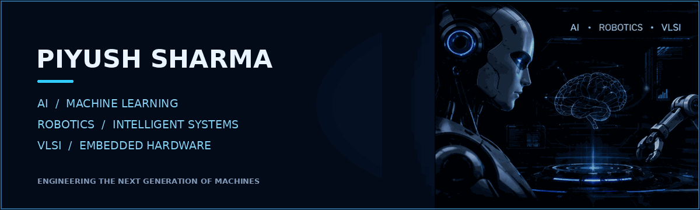

# 🤖 Hey, I'm Piyush!

### Artificial Intelligence | Machine Learning | Robotics

*Exploring the future of intelligent machines.*

---

## 🧠 NEURAL ROBOTICS UNIVERSE

**Artificial Intelligence × Robotic Intelligence**

---

## 🚀 What I'm Working On Currently

- 🧠 Exploring Machine Learning and Neural Networks.
- 🤖 Developing robotics and autonomous system projects.
- 👁️ Experimenting with Computer Vision and Deep Learning.
- ⚡ Exploring VLSI and hardware acceleration for AI.
- 🔬 Building intelligent systems through software and hardware integration.

## ⚙️ Featured Engineering Projects

- **INT8 Parallel MAC Accelerator** — CNN inference hardware using Verilog.
- **Low-Power Ring VCO** — CMOS circuit design using Cadence Virtuoso.
- **Crowd Surveillance** — Computer vision using SLLE and UMAP.
- **Robotics Projects** — Sensor-based mobile robots and embedded systems.

*More experiments and projects coming soon!*

---

## 🛠️ Technologies I Work With

**Hardware & Robotics:** Verilog HDL · Cadence Virtuoso · Vivado · ROS 2 · Gazebo · PyBullet

---

## 📊 GitHub Statistics

---

### 🌌 CONNECT WITH ME

  

**BUILDING INTELLIGENCE. ENGINEERING THE FUTURE.**

