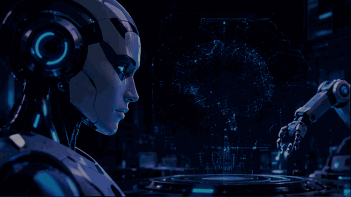

# PIYUSH SHARMA

### Aspiring AI & Robotics Engineer

**Artificial Intelligence · Machine Learning · Robotics · VLSI**

Building intelligent systems that connect algorithms, embedded hardware, and real-world machines.

[Portfolio](https://piyushsharma.pages.dev/) · [LinkedIn](https://www.linkedin.com/in/piyush-sharma-b95233277/)

---

### ABOUT ME

Electronics & Communication Engineering student at DCRUST, interested in intelligent machines and the technologies behind them.

### AREAS OF INTEREST

- 🧠 Artificial Intelligence & Deep Learning
- 👁️ Computer Vision
- 🤖 Robotics & Autonomous Systems
- ⚡ VLSI & Digital Hardware Design
- 🔬 Embedded Intelligence

### FEATURED PROJECTS

| Project | Technology |
|---|---|
| INT8 Parallel MAC Accelerator | Verilog, Vivado |
| Low-Power Ring VCO | Cadence Virtuoso |
| Crowd Surveillance | Python, SLLE, UMAP |
| Robotics Prototypes | Arduino, C/C++ |

### TECHNOLOGY STACK

`Python` `C++` `Verilog` `PyTorch` `OpenCV` `ROS 2` `Gazebo` `PyBullet` `Vivado` `Cadence Virtuoso`

---

### THINK INTELLIGENTLY. BUILD AUTONOMOUSLY.

