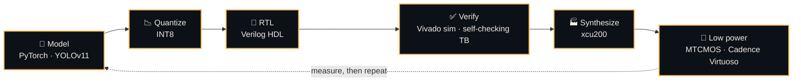

<p align="center">
  
</p>

<p align="center">
  <a href="https://piyushsharma.pages.dev"></a>
  <a href="https://www.linkedin.com/in/piyush-sharma-b95233277/"></a>
  <a href="mailto:piyushsharma47928@gmail.com"></a>
  
</p>

```verilog
module piyush_sharma #(
  parameter DEGREE  = "B.Tech ECE, VLSI specialization",
  parameter CAMPUS  = "DCRUST, Sonipat",
  parameter BATCH   = 2024,
  parameter FOCUS   = "AI x VLSI, low-power CMOS, robotics"
)(
  input  wire coffee, curiosity,
  output wire rtl, simulations, robots
);
  // Last internship : NIT Delhi, low-power VLSI in Cadence Virtuoso
  // Currently       : Coordinator, Thinkbots + Training & Placement Cell (ECE)
  // Toolchain       : Vivado 2025.1 · Cadence Virtuoso · KiCad · ROS2 · PyTorch
  assign rtl         = curiosity & coffee;
  assign simulations = rtl;        // if it is not simulated, it is not done
  assign robots      = simulations;
endmodule
```


## `> flow.md`

I like projects that cross the boundary between software that learns and silicon that runs it. A model is only half the story until it fits in a datapath.



## `> ls projects/`

<table>
  <tr>
    <td width="50%" valign="top">
      <h3>🔋 Low-Power Current-Starved Ring VCO</h3>
      Three-stage current-starved ring oscillator with MTCMOS standby-leakage suppression. Transistor-level schematics and simulation to study power, performance and area trade-offs.
      <br/><br/>
      <b>Measured oscillation frequency, control-voltage behavior, power and leakage current. Built at NIT Delhi, May–Jul 2026.</b>
      <br/><br/>
      <code>Cadence Virtuoso</code> <code>CMOS</code> <code>MTCMOS</code>
    </td>
    <td width="50%" valign="top">
      <h3>🧮 INT8 Quantized Parallel MAC Accelerator</h3>
      CNN-inference accelerator in Verilog RTL: 16 parallel multiply-accumulate lanes on 128-bit packed words, a 512-bit accumulator bus, an 8-state one-hot FSM and scale-and-shift requantization.
      <br/><br/>
      <b>6 of 6 self-checking tests pass in Vivado behavioral sim. Synthesizes for xcu200 with 0 errors, 1 warning.</b>
      <br/><br/>
      <code>Verilog HDL</code> <code>Vivado 2025.1</code> <code>AI × VLSI</code>
    </td>
  </tr>
  <tr>
    <td width="50%" valign="top">
      <h3>👁️ Crowd Surveillance, SLLE + UMAP</h3>
      Crowd analysis using Supervised Locally Linear Embedding and UMAP to reduce and visualize high-dimensional image data. I built the dataset prep, preprocessing and feature pipeline, then compared how each method separates classes.
      <br/><br/>
      <b>Contributed to a research paper submission. Jan–Mar 2026.</b>
      <br/><br/>
      <code>Python</code> <code>Computer Vision</code> <code>UMAP</code>
    </td>
    <td width="50%" valign="top">
      <h3>🤖 Robotics & Embedded</h3>
      A Line Following Robot and a Maneuvering Robot with sensor-driven control logic and directional motion handling for real-time response. Also a Python talking bot with audio output.
      <br/><br/>
      <b>Built through Thinkbots, the DCRUST technical society. Smart India Hackathon team leader (school surveillance system).</b>
      <br/><br/>
      <code>Sensors</code> <code>Control</code> <code>Python</code>
    </td>
  </tr>
</table>

<p align="center"></p>

## `> cat experience.log`

| When | Where | What |
|---|---|---|
| May – Jul 2026 | **NIT Delhi** · Research Intern | Low-power VLSI design project in Cadence Virtuoso. Documented and presented the work. |
| Mar 2025 – now | **DCRUST** · Training & Placement Coordinator, ECE | Link between students, faculty and the Training & Placement Cell. |
| Dec 2024 – now | **Thinkbots**, DCRUST Technical Society · Team Member & Coordinator | Runs technical activities and hands-on robotics and hardware projects. |
| Jul 2025 | **Government of Uttar Pradesh** · CDPO Community Internship, Aligarh | Community-facing work in a government office. |

## `> which tools`

<p align="center"></p>

## `> cat now.txt`

```diff
+ DCRUST            B.Tech ECE with VLSI specialization, 2024 to now
+ Thinkbots         coordinating robotics and hardware builds for the technical society
+ TPC (ECE)         coordinating training and placement activity for the department
! next              more AI x VLSI: take the INT8 accelerator further down the flow
```

## `> git log --activity`

<p align="center">
  <picture>
    <source media="(prefers-color-scheme: dark)" srcset="https://raw.githubusercontent.com/Piyush-47928/Piyush-47928/output/snake-dark.svg"/>
    
  </picture>
</p>

<p align="center">
  
  
</p>

## `> contact`

Email **piyushsharma47928@gmail.com** · [LinkedIn](https://www.linkedin.com/in/piyush-sharma-b95233277/) · [piyushsharma.pages.dev](https://piyushsharma.pages.dev)

<sub>Profile built from my resume. Banner, pinout and waveform are hand-generated SVGs in <code>assets/</code>.</sub>
