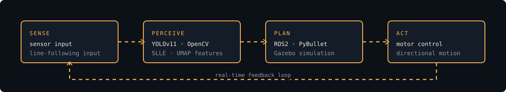
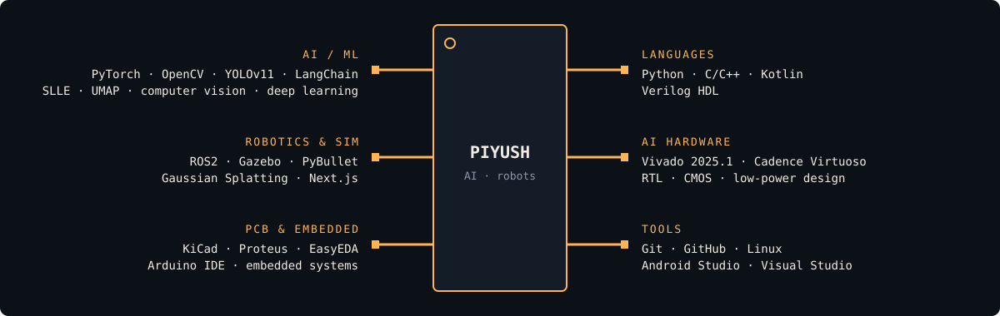

<p align="center">
  
</p>

<p align="center">
  <a href="https://piyushsharma.pages.dev"></a>
  <a href="https://www.linkedin.com/in/piyush-sharma-b95233277/"></a>
  <a href="mailto:piyushsharma47928@gmail.com"></a>
  
</p>

```python
class PiyushSharma(Engineer):
    degree  = "B.Tech ECE, VLSI specialization"      # DCRUST, Sonipat · 2024 to now
    focus   = ["computer vision", "robotics", "AI hardware"]
    stack   = ["PyTorch", "OpenCV", "YOLOv11", "ROS2", "Gazebo", "PyBullet"]
    leads   = ["Thinkbots (robotics society)", "Training & Placement Cell, ECE"]
    research = "NIT Delhi, 2026"                      # low-power VLSI, Cadence Virtuoso

    def build(self, idea):
        sim = self.simulate(idea)                     # if it is not simulated, it is not done
        return self.deploy(sim) if sim.passes else self.iterate(idea)
```


## `> loop.md`

Robots are a loop: sense, perceive, plan, act. I like working on every step of it, including the silicon underneath.

<p align="center"></p>
## `> ls projects/`

Six builds, each with a result you can check.

<table>
  <tr>
    <td width="50%" valign="top">
      <h3>👁️ <a href="https://github.com/Piyush-47928?tab=repositories">crowd-surveillance-slle-umap</a></h3>
      Crowd surveillance and analysis with Supervised Locally Linear Embedding and UMAP: dataset prep, image preprocessing and a feature pipeline, comparing how each method separates classes in high-dimensional image data.
      <br/><br/>
      <b>Contributed to a research paper submission. Jan–Mar 2026.</b>
      <br/><br/>
      <code>Python</code> <code>OpenCV</code> <code>SLLE</code> <code>UMAP</code>
    </td>
    <td width="50%" valign="top">
      <h3>🤖 <a href="https://github.com/Piyush-47928?tab=repositories">line-following-robot</a></h3>
      Line Following Robot and Maneuvering Robot with sensor-based input processing, control logic and directional motion handling for real-time response. Built with Thinkbots at DCRUST.
      <br/><br/>
      <b>Two working robots: sensors in, motor control out, running in real time.</b>
      <br/><br/>
      <code>Sensors</code> <code>Control logic</code> <code>Embedded</code> <code>Arduino</code>
    </td>
  </tr>
  <tr>
    <td width="50%" valign="top">
      <h3>🏫 <a href="https://github.com/Piyush-47928?tab=repositories">school-surveillance-sih</a></h3>
      Smart India Hackathon project: a school surveillance system, built with me as team leader.
      <br/><br/>
      <b>Led the team as Team Leader at Smart India Hackathon.</b>
      <br/><br/>
      <code>Computer Vision</code> <code>Team lead</code> <code>SIH</code>
    </td>
    <td width="50%" valign="top">
      <h3>🧮 <a href="https://github.com/Piyush-47928?tab=repositories">int8-mac-accelerator</a></h3>
      INT8 CNN-inference accelerator in Verilog RTL: 16 parallel multiply-accumulate lanes on 128-bit packed words, a 512-bit accumulator bus, an 8-state one-hot FSM controller and scale-and-shift requantization.
      <br/><br/>
      <b>6 checks passed, 0 failed in Vivado behavioral sim. Synthesized for xcu200: 0 errors, 1 warning.</b>
      <br/><br/>
      <code>Verilog HDL</code> <code>Vivado 2025.1</code> <code>AI × VLSI</code>
    </td>
  </tr>
  <tr>
    <td width="50%" valign="top">
      <h3>🔋 <a href="https://github.com/Piyush-47928?tab=repositories">ring-vco-mtcmos</a></h3>
      Ultra-low-power three-stage current-starved ring VCO with MTCMOS standby-leakage suppression. Transistor-level schematic and simulation in Cadence Virtuoso to study power, performance and area trade-offs.
      <br/><br/>
      <b>Evaluated oscillation frequency, control voltage, power and leakage current. NIT Delhi, May–Jul 2026.</b>
      <br/><br/>
      <code>Cadence Virtuoso</code> <code>CMOS</code> <code>MTCMOS</code>
    </td>
    <td width="50%" valign="top">
      <h3>🗣️ <a href="https://github.com/Piyush-47928?tab=repositories">python-talking-bot</a></h3>
      A Python talking bot with audio output, built around input–output handling and automation logic.
      <br/><br/>
      <b>Speaks its responses aloud through audio output.</b>
      <br/><br/>
      <code>Python</code> <code>Audio</code> <code>Automation</code>
    </td>
  </tr>
</table>

## `> cat experience.log`

| When | Where | What |
|---|---|---|
| Dec 2024 – now | **Thinkbots**, DCRUST Technical Society · Team Member & Coordinator | Runs technical activities and hands-on robotics and hardware projects. |
| Mar 2025 – now | **DCRUST** · Training & Placement Coordinator, ECE | Link between students, faculty and the Training & Placement Cell. |
| May – Jul 2026 | **NIT Delhi** · Research Intern | Low-power VLSI design project in Cadence Virtuoso. Documented and presented the work. |
| Jul 2025 | **Government of Uttar Pradesh** · CDPO Community Internship, Aligarh | Community-facing work in a government office. |

I have also delivered a speech on robotics and AI.

## `> which tools`

<p align="center"></p>

<p align="center">
  
</p>

## `> cat now.txt`

```diff
+ Thinkbots         coordinating robotics and hardware builds for the technical society
+ TPC (ECE)         coordinating training and placement activity for the department
+ DCRUST            B.Tech ECE with VLSI specialization, 2024 to now
! exploring         ROS2, Gazebo, PyBullet and Gaussian Splatting
```

## `> cat learning.txt`

```text
[x] Computer vision               OpenCV, YOLOv11, image preprocessing
[x] Dimensionality reduction      SLLE, UMAP, class separation
[x] Sensor-driven robots          line following, maneuvering, control logic
[~] Robotics simulation           ROS2, Gazebo, PyBullet
[~] 3D scene capture              Gaussian Splatting
[ ] Edge AI hardware              taking the INT8 accelerator further down the flow
```

## `> git log --graph`

<p align="center">
  
</p>

<p align="center">
  
</p>

<p align="center">
  <picture>
    <source media="(prefers-color-scheme: dark)" srcset="https://raw.githubusercontent.com/Piyush-47928/Piyush-47928/output/snake-dark.svg"/>
    
  </picture>
</p>

<p align="center">
  
  
</p>

> "If it is not simulated, it is not done."

## `> contact`

Email **piyushsharma47928@gmail.com** · [LinkedIn](https://www.linkedin.com/in/piyush-sharma-b95233277/) · [piyushsharma.pages.dev](https://piyushsharma.pages.dev)
